# PLL0663 – Datasheet

Phase-locked loop in IHP SG13CMOS5L · Release v1.0.0

## 1. Overview

PLL0663 is a phase-locked loop for the IHP SG13CMOS5L process. It consists of a
phase-frequency detector (PFD), a charge pump (CP), several voltage-controlled oscillators (VCO)
selected by a VCO decoder, a programmable divider, an input register and an on-chip bandgap reference. The loop
filter is **external** (off-chip).

### Key features

- Output frequency range: 32 kHz – 150 MHz
- Reference frequency: 32 kHz
- Divider ratio N: 2 – 9984; `f_out = N × f_ref / 2` (the output is divided by 2)
- Core supply `vp` 1.2 V; all circuits inside the PLL run from 1.2 V
- 3.3 V supply `vph` for the input buffers only; bandgap supply `vp_bandgap` 3.3 V
- Serial input register (`clk_in`, `data_in`, `data_en`) for the divider code and the debug multiplexer code
- Debug output (`debug_out`) with a multiplexer for internal test signals
- On-chip bandgap reference
- Power consumption up to 100 mW (at the highest output frequency)
- Lock time: 1 ms (see section 7 for conditions)
- Silicon area: 1050 µm × 1050 µm including sealring (1.1025 mm²)

## 2. Block diagram

  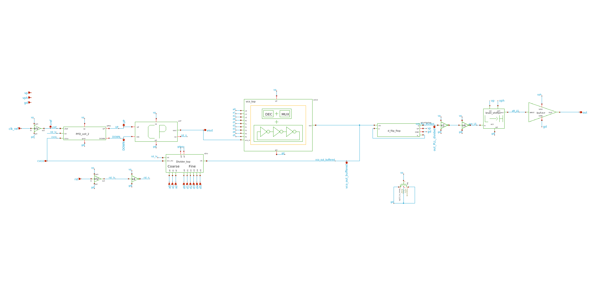 
  <em>Figure 1: PLL top-level schematic (<code>PLL_top</code>)</em>

  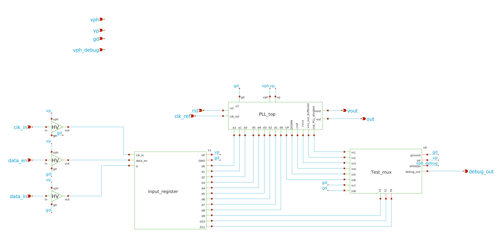 
  <em>Figure 2: chip top-level schematic (<code>Chip_top</code>)</em>

## 3. Pin description

Pin names are those of the extracted top-level subcircuit. All signal pins and the supplies `vph`
and `vp_bandgap` are in the 3.3 V domain; `vp` is the 1.2 V core supply. Only the input buffers are
supplied from `vph`; all circuits inside the PLL are supplied from `vp` (1.2 V).

| Pin | Direction | Domain | Description |
|---|---|---|---|
| `gd` | supply | 0 V | Ground |
| `vp` | supply | 1.2 V | Core supply (all circuits inside the PLL) |
| `vph` | supply | 3.3 V | 3.3 V supply of the input buffers only |
| `vp_bandgap` | supply | 3.3 V | Bandgap supply |
| `clk_ref` | in | 3.3 V | Reference clock (32 kHz) |
| `rst` | in | 3.3 V | Reset, active high; resets all elements of the PLL |
| `clk_in` | in | 3.3 V | Input register: external clock of the serial interface |
| `data_in` | in | 3.3 V | Input register: serial data (divider code and debug multiplexer code) |
| `data_en` | in | 3.3 V | Input register: enable; while asserted, `data_in` is shifted into the register on successive `clk_in` clock cycles |
| `out` | out | 3.3 V | PLL output clock |
| `vout` | analog | 3.3 V | Charge-pump / VCO control node, connection of the external loop filter |
| `debug_out` | out | 3.3 V | Output of the debug multiplexer (internal test signals, selected via the input register) |
| `vref_sb` | analog | 3.3 V | Bandgap pin (TODO: exact function) |
| `vref_res` | analog | 3.3 V | Bandgap pin (TODO: exact function) |

### 3.1 Input register

The input register is a serial-in, parallel-out (SIPO) shift register, loaded through `clk_in`,
`data_in` and `data_en`. `clk_in` is an external clock (independent of `clk_ref`). As long as
`data_en` is asserted, `data_in` is shifted into the register on successive `clk_in` clock cycles.

The serial word is 12 bits long:

| Bits | Field |
|---|---|
| D0 – D9 | divider code (10 bits) |
| D10 – D11 | code of the debug output multiplexer (2 bits, selects the signal routed to `debug_out`) |

The register content is valid only after the transmission of the last bit (D11) is complete.

  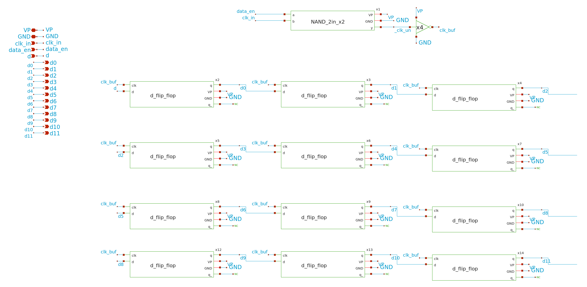 
  <em>Figure 3: input register (<code>input_register</code>)</em>

TODO: bit order on the line (assumed D0 first, D11 last), timing diagram (setup/hold of `data_in`
and `data_en` with respect to `clk_in`, maximum `clk_in` frequency), active level of `data_en`,
debug multiplexer codes and the signal selected by each code.

### 3.2 Output buffer and level shifters

<table>
<tr>
<td align="center" width="50%">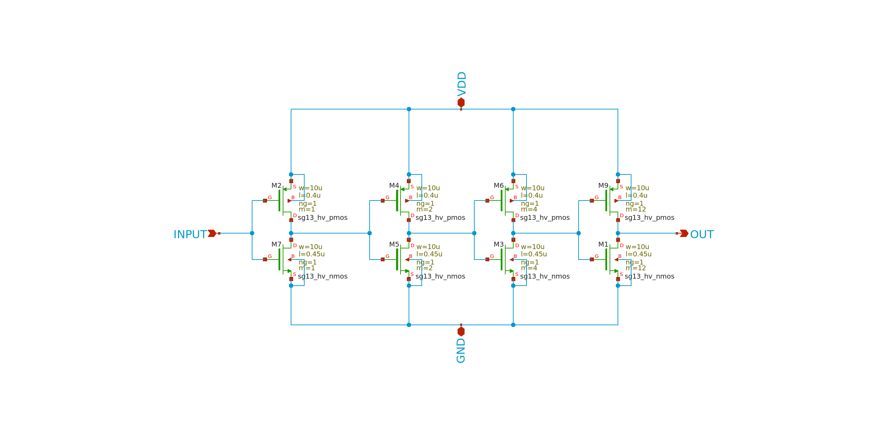 <em>Figure 4: output buffer (<code>buf</code>)</em></td>
<td align="center" width="50%">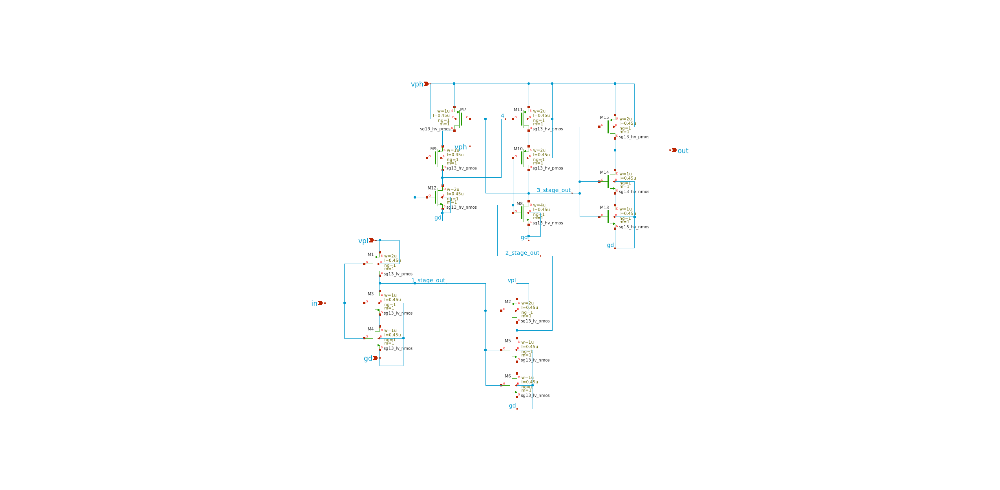 <em>Figure 5: level shifter (<code>level_shifter</code>)</em></td>
</tr>
</table>

TODO: short description (which pins use them, 3.3 V to 1.2 V translation).

TODO: pad ring floorplan (position of every pad) as an image or table.

## 4. Operating conditions

| Parameter | Min | Typ | Max | Unit |
|---|---|---|---|---|
| Core supply `vp` | 1.08 | 1.2 | 1.32 | V |
| 3.3 V supplies `vph`, `vp_bandgap` | 3.1 | 3.3 | 3.5 | V |
| Temperature | -25 | 27 | 125 | °C |
| Reference frequency | – | 32 | – | kHz |

The ranges above are the simulated ranges. Process corners simulated: `mos_tt`, `mos_ss`, `mos_ff`,
`mos_sf`, `mos_fs`.

Absolute maximum ratings: TODO (take from the PDK documentation for the devices used).

## 5. Electrical characteristics

Conditions: process corner `mos_tt`, `vp` = 1.2 V, `vph` = 3.3 V, 27 °C unless stated otherwise.

| Parameter | Min | Typ | Max | Unit | Source |
|---|---|---|---|---|---|
| Output frequency | 0.032 | – | 150 | MHz | TODO: simulation reference |
| Divider ratio | 2 | – | 9984 | – | design |
| Lock time | – | 1 | – | ms | `PLL_top_tb.sch` |
| Power consumption | – | TODO | 100 | mW | TODO (at 150 MHz) |
| Charge-pump current | TODO | TODO | TODO | µA | TODO |
| VCO gain | TODO | TODO | TODO | MHz/V | TODO |
| Phase noise / jitter | TODO | TODO | TODO | – | TODO or "not characterised" |
| Bandgap output voltage | TODO | TODO | TODO | V | TODO |
| Bandgap temperature coefficient | TODO | TODO | TODO | ppm/°C | TODO or "not characterised" |
| Bandgap supply current | TODO | TODO | TODO | µA | TODO |

## 6. Functional description

### 6.1 Phase-frequency detector (PFD)

  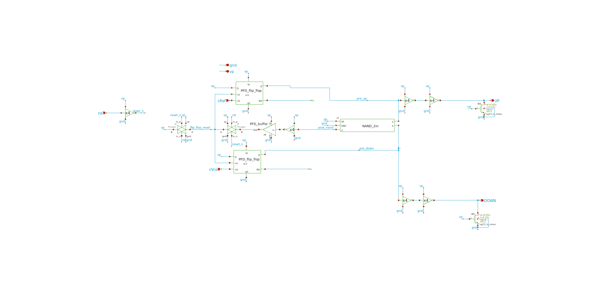 
  <em>Figure 6: PFD cell (<code>PFD_cell_2</code>)</em>

  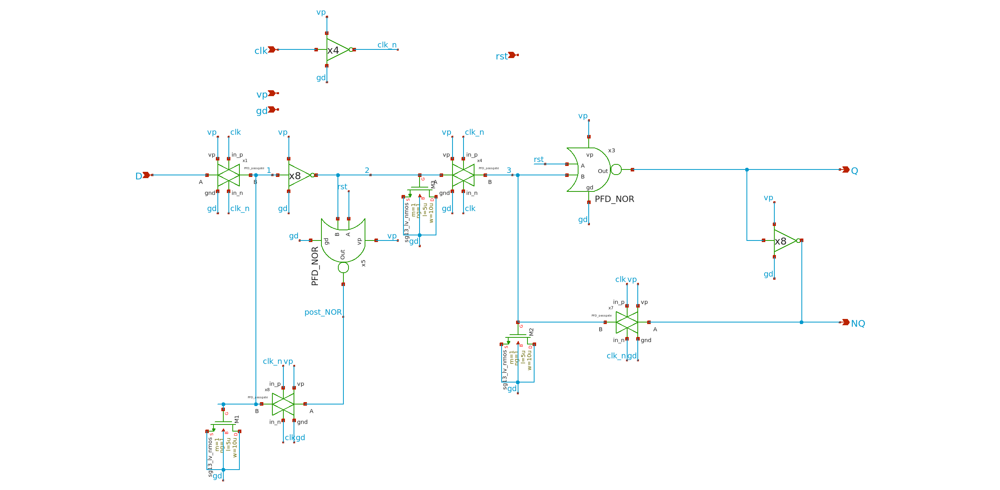 
  <em>Figure 7: PFD flip-flop (<code>PFD_flip_flop</code>)</em>

TODO: topology, dead zone / reset delay, input frequency range.

### 6.2 Charge pump (CP)

  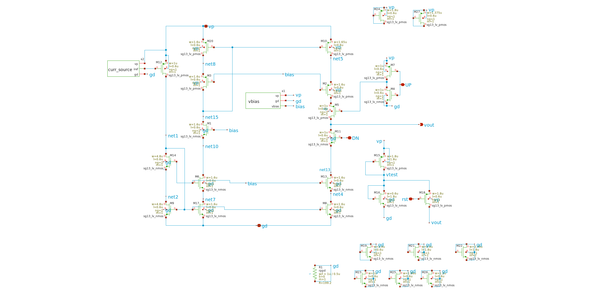 
  <em>Figure 8: charge pump cell (<code>charge_pump_cell</code>)</em>

<table>
<tr>
<td align="center" width="50%">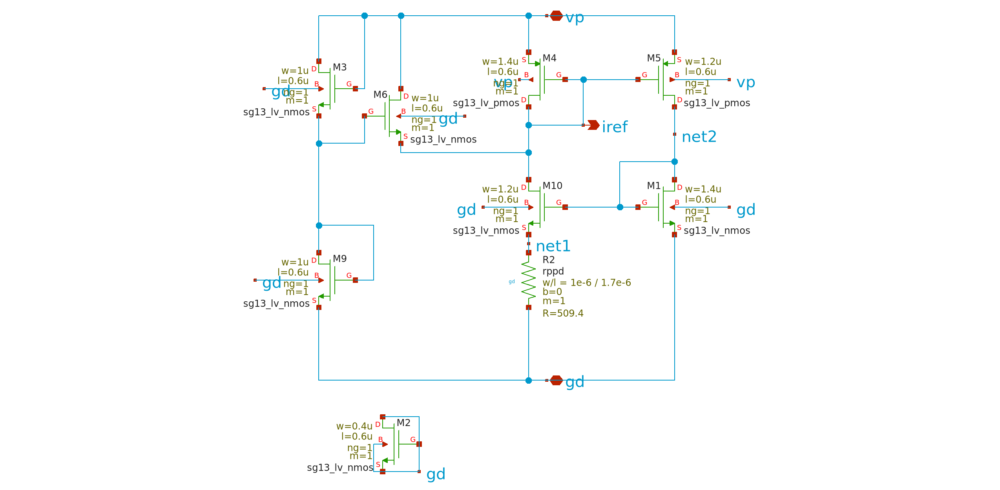 <em>Figure 9: current source (<code>curr_source</code>)</em></td>
<td align="center" width="50%">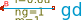 <em>Figure 10: bias generator (<code>vbias</code>)</em></td>
</tr>
</table>

TODO: topology, output current, up/down matching, output voltage range.

### 6.3 Voltage-controlled oscillators (VCO) and VCO decoder

  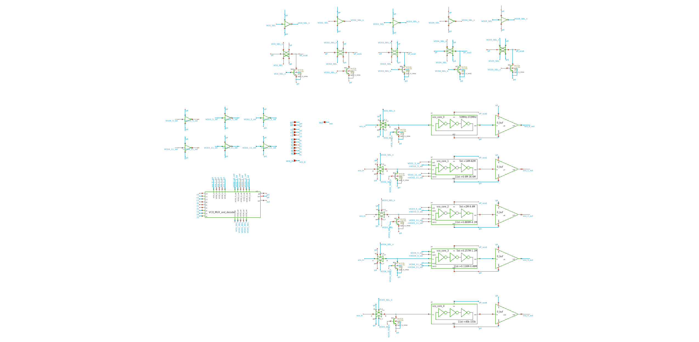 
  <em>Figure 11: VCO top level (<code>vco_top</code>)</em>

  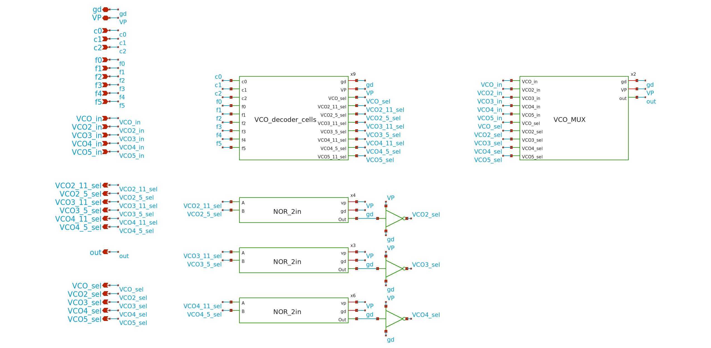 
  <em>Figure 12: VCO multiplexer and decoder (<code>VCO_MUX_and_decoder</code>)</em>

  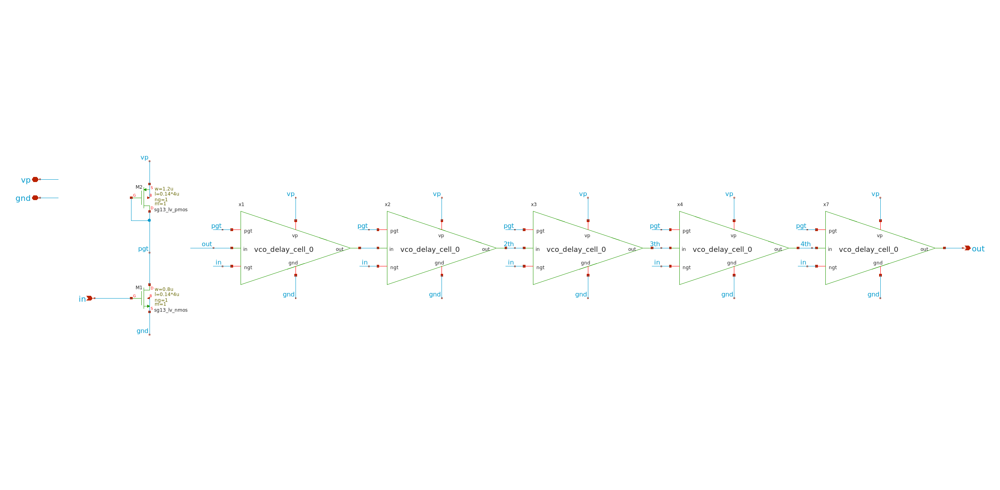 
  <em>Figure 13: VCO core 0 (<code>vco_core_0</code>)</em>

  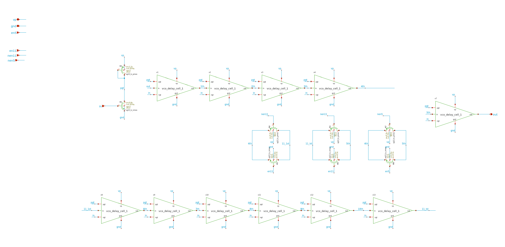 
  <em>Figure 14: VCO core 1 (<code>vco_core_1</code>)</em>

  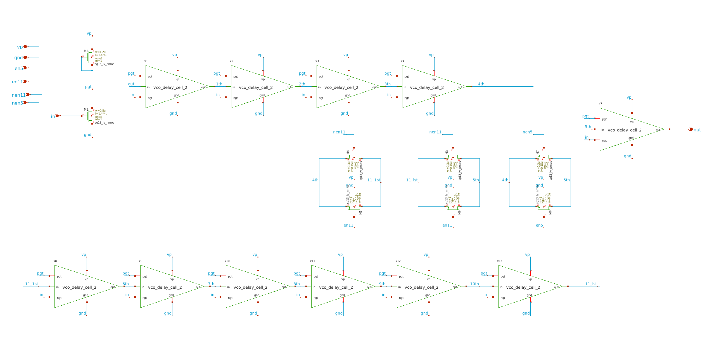 
  <em>Figure 15: VCO core 2 (<code>vco_core_2</code>)</em>

  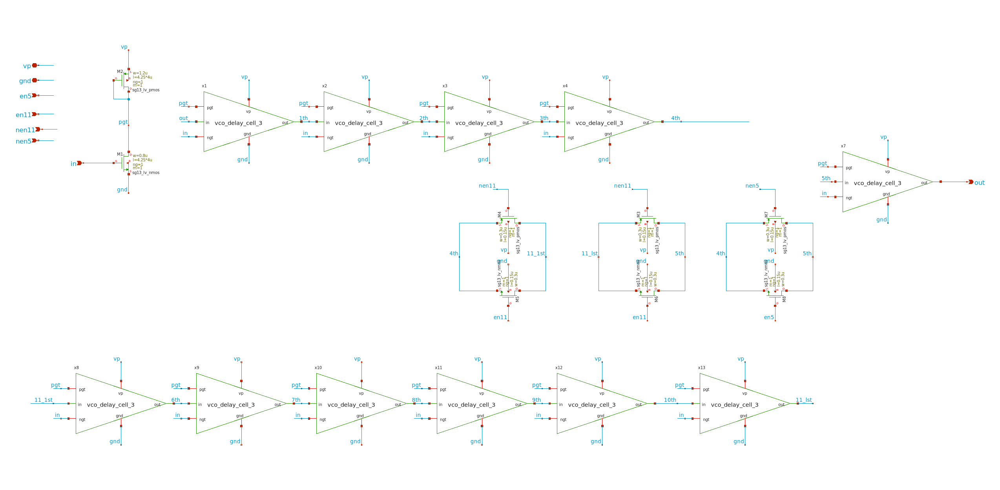 
  <em>Figure 16: VCO core 3 (<code>vco_core_3</code>)</em>

  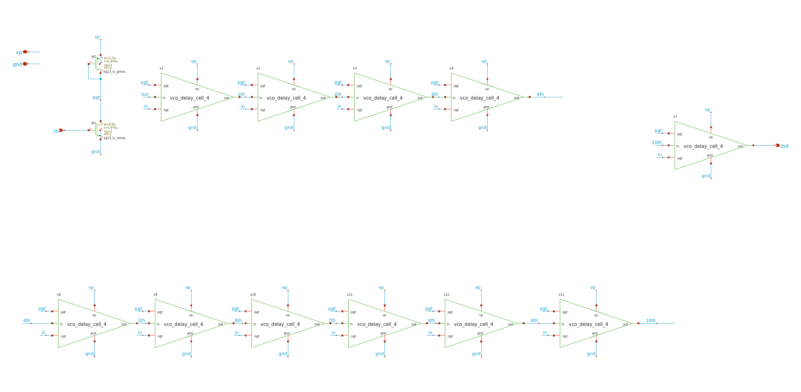 
  <em>Figure 17: VCO core 4 (<code>vco_core_4</code>)</em>

The PLL contains five VCO cores (`vco_core_0` – `vco_core_4`), each covering a part of the output
frequency range. The VCO decoder selects which VCO is active.

TODO: oscillator topology, frequency range of each VCO, what drives the decoder
(divider code or a separate input) and the decoder codes (table).

### 6.4 Divider

  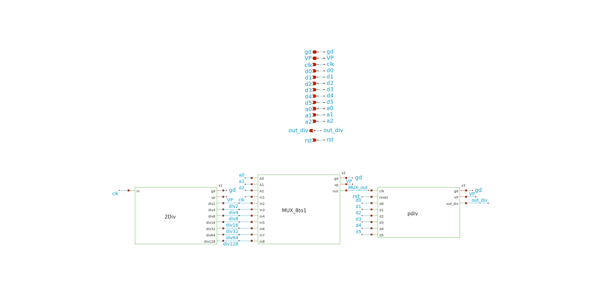 
  <em>Figure 18: divider top level (<code>Divider_top</code>)</em>

The output of the VCO is divided by 2 to form `out`, therefore `f_out = N × f_ref / 2`. With
`f_ref` = 32 kHz the minimum ratio N = 2 gives the lowest output frequency of 32 kHz.

The divider code is 10 bits wide (D0 – D9) and is written through the input register
(section 3.1).

TODO: structure, encoding of the 10-bit code into the ratio 2 – 9984, timing of changes.

### 6.5 Bandgap reference
TODO: topology, output voltage and which pin carries it (`vref_sb`, `vref_res`), what it is used for
inside the chip, supply range (`vp_bandgap`), start-up behaviour, simulated temperature and supply
dependence.

### 6.6 External loop filter
The loop filter is not part of the chip and is connected to `vout`. The simulated results in
section 7 were obtained with:

| Element | Value |
|---|---|
| R1 | 50 kΩ |
| C1 | 100 pF |
| C2 (if used) | 1 µF |
| Loop bandwidth | TODO |
| Phase margin | TODO |

  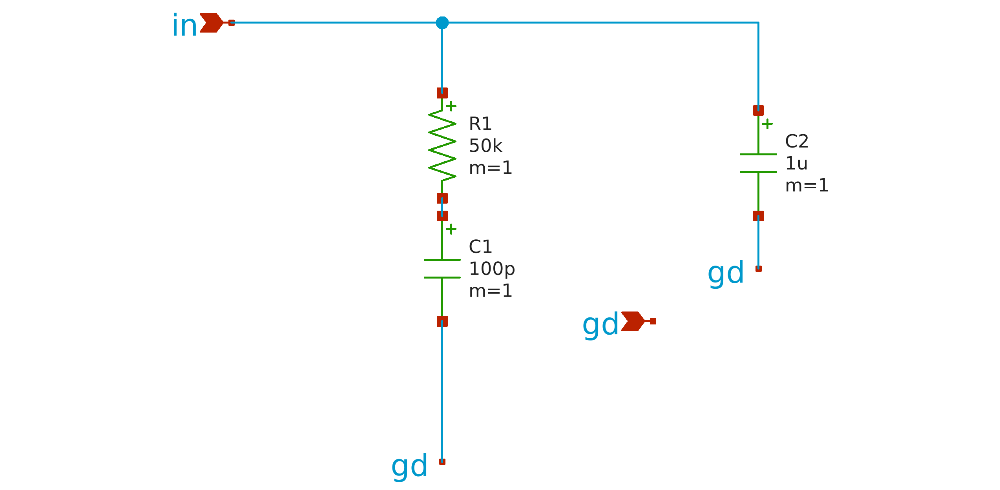 
  <em>Figure 19: external loop filter (<code>RC_filter</code>)</em>

Topology: the filter node `in` is connected to `vout`. C2 connects `vout` to ground, and in parallel to it R1 in series with C1 connects `vout` to ground.

### 6.7 Debug output multiplexer

The debug output multiplexer routes one of the internal test signals to `debug_out`. The selected
signal is set by the 2-bit debug code (D10 – D11) written through the input register (section 3.1).
The multiplexer output is buffered by a low-power buffer (`buf_lp`). These blocks are intended for
testing and debugging only.

  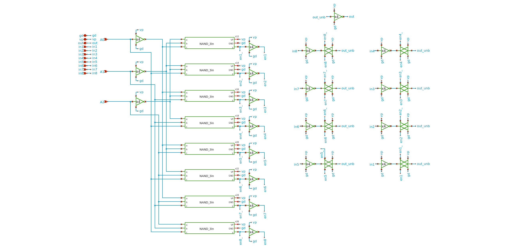 
  <em>Figure 20: 8-to-1 multiplexer (<code>mux8to1</code>)</em>

  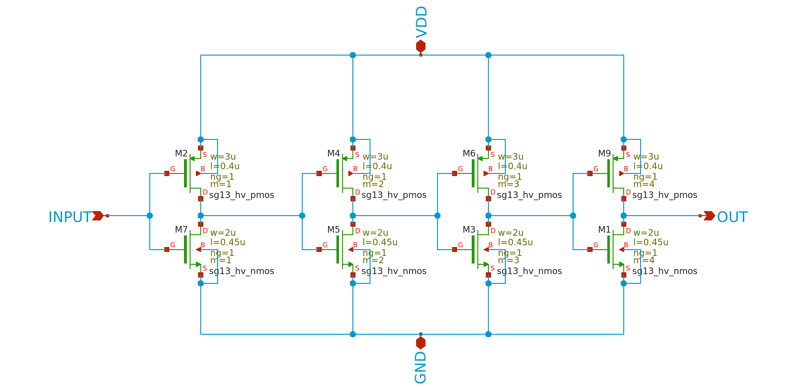 
  <em>Figure 21: debug output buffer (<code>buf_lp</code>)</em>

Signals connected to the inputs of `mux8to1`:

| Mux input | Signal | Description |
|---|---|---|
| in1 | `out_PLL_divided` | PLL output signal after the divider |
| in2 | `vco_out_buffered` | buffered VCO output |
| in3 | `cvco` | VCO clock |
| in4 | `cref` | reference clock |
| in5 | `DOWN` | PFD DOWN signal |
| in6 | `UP` | PFD UP signal |
| in7 | `gd` | tied to ground (unused) |
| in8 | `gd` | tied to ground (unused) |

TODO: select code of each input. `mux8to1` has 8 inputs (3 select bits) while the debug code in the
input register is 2 bits wide (D10 – D11), describe how the select lines are driven.

## 7. Simulation results

| Testbench | Conditions | Result |
|---|---|---|
| `testbenches/tran/xschem/top/PLL_top_tb.sch` | `mos_tt`, 1.2 V, 27 °C | lock at 1 MHz, lock time 1 ms |

Simulated ranges: temperature -25 / 27 / 125 °C; `vp` 1.08 / 1.2 / 1.32 V; `vph` 3.1 / 3.3 / 3.5 V;
corners `mos_tt`, `mos_ss`, `mos_ff`, `mos_sf`, `mos_fs`.

Plots: `top_results/` (TODO: list file names).

Block-level results (VCO tuning curve, charge-pump current vs. output voltage, PFD transfer
function) and results over process corners, supply and temperature are collected in the
`measurements` directory (TODO: exact path).

Post-layout (PEX) simulation: all blocks were simulated individually from extracted layout, and
the complete PLL was simulated from extracted layout as well. Only parasitic capacitances (C) were
extracted; parasitic resistances were not included. The extraction was done with Magic, run
through the `sak-pex.sh` script.
TODO: Magic version and extraction options.

## 8. Startup and usage

1. Apply supplies in this order: TODO (core 1.2 V / pad 3.3 V).
2. Connect the external loop filter to `vout` (section 6.6).
3. Apply the 32 kHz reference clock to `clk_ref`.
4. Write the divider code and the debug multiplexer code serially into the input register using
   `clk_in`, `data_in` and `data_en` (section 3.1, 6.4).
5. Wait for lock (about 1 ms in simulation).

## 9. Physical implementation

| Item | Value |
|---|---|
| Technology | IHP SG13CMOS5L |
| Top cell | `PLL0663` |
| Layout | `release/v.1.0.0/gds/PLL0663.gds` |
| Size | 1050 µm × 1050 µm (sealring) |
| Pads | cells from the PDK I/O library `sg13cmos5l_io`, not modified |
| PDK revision | `a49358cc0b20635fcb53c0940505e3563763fc7a` (IHP-Open-PDK) |

## 10. Verification

| Check | Result |
|---|---|
| DRC main table, mandatory rules | PASS |
| DRC main table, recommended rules | 41 findings (`Pad.fR_TM1`, unmodified library pads), waived |
| DRC density table | PASS |
| LVS | PASS |

Details and reports: `release/v.1.0.0/ReleaseNote.md` and `PLL0663-main/verification/`.

## 11. Known limitations

- The loop filter must be designed by the user.
- TODO: further limitations (e.g. no silicon measurements yet, characterisation over temperature).

## 12. Revision history

| Version | Date | Changes |
|---|---|---|
| 1.0.0 | TODO | Initial release |
